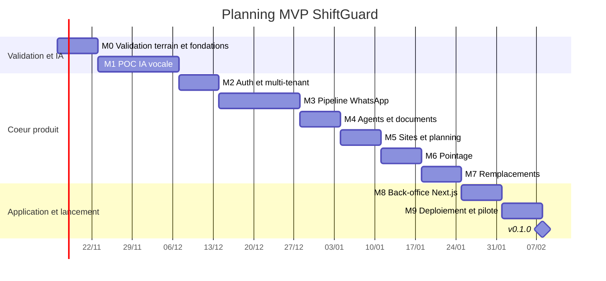

# ShiftGuard — Plan MVP (12 semaines)

## 1. Jalons

Hypothèse de calendrier : S1 commence le lundi 2026-11-16, environ 30 h par semaine, sans congés comptés.

| Jalon | Semaines | Contenu | Critère de sortie |
|---|---|---|---|
| M0 | S1 | Validation terrain et fondations : entretiens avec 10 à 15 sociétés de gardiennage / intérim, collecte de 30 vocaux de candidats réels (avec consentement), CI GitHub Actions (`pytest`, `ruff`, `eslint`), première migration Alembic | Synthèse des entretiens, au moins 3 sociétés prêtes à tester ; CI verte sur `main` |
| M1 | S2-S3 | POC IA vocale : `transcribe()` branché (Groq et OpenAI comparés), `extract_candidate()` avec `CandidateExtraction` v1, prompt `extraction.v1`, jeu de 30 vocaux annotés, script `run_eval.py` | Rapport d'éval par fournisseur (qualité de transcription darija, précision par champ, coût et latence) ; décision de la porte M1 (§2) |
| M2 | S4 | Auth et multi-tenant : inscription du tenant, `users` et rôles (`admin`, `planner`, `supervisor`), JWT, `tenant_id` lu depuis le token (suppression de `X-Tenant-ID`), test `test_tenant_isolation` | Aucun accès croisé entre deux tenants en test ; parcours inscription → connexion → appel API protégé |
| M3 | S5-S6 | Pipeline WhatsApp : numéro de test Meta, vérification `X-Hub-Signature-256`, `process_incoming_message` complet, idempotence par `message.id`, médias stockés dans MinIO, conversation guidée (questions sur les champs manquants), scoring | Un vrai candidat postule par vocal, apparaît scoré dans l'API ; message rejoué = aucun doublon |
| M4 | S7 | Agents et documents : conversion candidat → agent, upload des pièces (CIN, casier, carte pro), URLs signées, cron `check_expiring_documents` et alertes | Alerte reçue pour un document qui expire dans 30 jours ; fichiers jamais en base |
| M5 | S8 | Sites et planning : CRUD `sites` et `shifts`, détection des chevauchements, vue semaine côté API | Planning d'une semaine pour 3 sites et 20 agents créé sans conflit ; tests des chevauchements |
| M6 | S9 | Pointage : QR signé par site, page web mobile de scan, geofence GPS, statuts `in_progress` / `done` / `missed`, rapport des retards | Check-in refusé hors zone ou avec un QR invalide ; rapport des retards du jour |
| M7 | S10 | Remplacements : sélection des agents disponibles (pas de chevauchement, même ville, documents valides), template WhatsApp validé par Meta, premier « OUI » affecté, confirmation aux autres | Shift libéré → remplaçant affecté en moins de 15 min en test réel |
| M8 | S11 | Back-office Next.js : `/candidates`, `/agents`, `/sites`, `/planning`, `/attendance`, shadcn/ui + TanStack Query | Parcours principaux couverts par des tests Playwright |
| M9 | S12 | Déploiement et pilote : VPS (Docker Compose + Caddy), sauvegardes Postgres et MinIO, dossier CNDP, `v0.1.0`, pilote avec 1 à 2 sociétés | `v0.1.0` en prod, restauration testée, premier client pilote actif |

## 2. Porte de décision M1

| Résultat mesuré sur les 30 vocaux annotés | Décision |
|---|---|
| Transcription darija exploitable et champs clés (nom, ville, carte pro, expérience, disponibilité) extraits correctement dans au moins 80 % des cas | Le vocal reste le parcours principal du candidat |
| Transcription correcte en français / arabe mais faible en darija | Vocal accepté, mais complété par des questions guidées (boutons de réponse rapide WhatsApp) pour les champs clés |
| Résultats insuffisants pour tous les fournisseurs | Parcours par questions guidées uniquement, vocal stocké pour lecture humaine ; nouvel essai à la V2 |

## 3. Règles de coupe

En cas de retard, dans cet ordre :

1. Remplacements automatiques (M7) réduits à un bouton « proposer ce shift » qui envoie le message à une liste choisie à la main.
2. Pointage GPS retiré, QR seul.
3. Vue planning réduite à une liste filtrable.
4. Rapport des retards reporté à la V2.

Ne sont jamais coupés : isolation entre tenants, consentement des candidats et dossier CNDP, vérification de la signature des webhooks, chiffrement et URLs signées des documents, sauvegardes.

## 4. Façon de travailler

- Un jalon à la fois ; dans un jalon, une tâche à la fois, une branche `feat/<scope>-<sujet>` et un commit par tâche.
- Conventional Commits avec les scopes `api`, `web`, `infra`, `ci`, `docs`.
- À la fin de chaque jalon : critère de sortie vérifié, `README.md` (roadmap) mis à jour.
