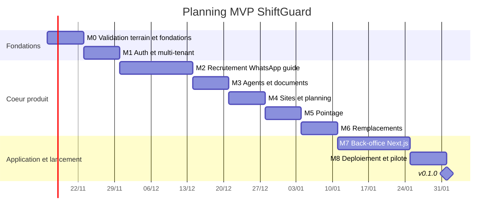

# ShiftGuard — Plan MVP (11 semaines)

## 1. Jalons

Hypothèse de calendrier : S1 commence le lundi 2026-11-16, environ 30 h par semaine, sans congés comptés.

Choix de la V1 : **pas de vocal ni d'IA générative**. Le candidat répond à des questions guidées (boutons et listes WhatsApp), le profil est rempli directement par ses réponses et le score est calculé par des règles. Le vocal arrive en V2 (§3).

| Jalon | Semaines | Contenu | Critère de sortie |
|---|---|---|---|
| M0 | S1 | Validation terrain et fondations : entretiens avec 10 à 15 sociétés de gardiennage / intérim, liste des questions à poser aux candidats validée avec elles, CI GitHub Actions (`pytest`, `ruff`, `eslint`), première migration Alembic | Synthèse des entretiens, au moins 3 sociétés prêtes à tester ; questionnaire candidat figé ; CI verte sur `main` |
| M1 | S2 | Auth et multi-tenant : inscription du tenant, `users` et rôles (`admin`, `planner`, `supervisor`), JWT, `tenant_id` lu depuis le token (suppression de `X-Tenant-ID`), test `test_tenant_isolation` | Aucun accès croisé entre deux tenants en test ; parcours inscription → connexion → appel API protégé |
| M2 | S3-S4 | Recrutement WhatsApp guidé : numéro de test Meta, vérification `X-Hub-Signature-256`, idempotence par `message.id`, conversation à étapes (ville, carte pro, expérience, disponibilité) avec messages interactifs (boutons / listes), reprise si le candidat revient plus tard, scoring par règles, vocal ou fichier reçu stocké dans MinIO pour le RH avec relance vers les questions | Un vrai candidat termine le questionnaire et apparaît scoré dans l'API ; message rejoué = aucun doublon ; vocal reçu = stocké et candidat relancé |
| M3 | S5 | Agents et documents : conversion candidat → agent, upload des pièces (CIN, casier, carte pro), URLs signées, cron `check_expiring_documents` et alertes | Alerte reçue pour un document qui expire dans 30 jours ; fichiers jamais en base |
| M4 | S6 | Sites et planning : CRUD `sites` et `shifts`, détection des chevauchements, vue semaine côté API | Planning d'une semaine pour 3 sites et 20 agents créé sans conflit ; tests des chevauchements |
| M5 | S7 | Pointage : QR signé par site, page web mobile de scan, geofence GPS, statuts `in_progress` / `done` / `missed`, rapport des retards | Check-in refusé hors zone ou avec un QR invalide ; rapport des retards du jour |
| M6 | S8 | Remplacements : sélection des agents disponibles (pas de chevauchement, même ville, documents valides), template WhatsApp validé par Meta, premier « OUI » affecté, confirmation aux autres | Shift libéré → remplaçant affecté en moins de 15 min en test réel |
| M7 | S9-S10 | Back-office Next.js : `/candidates` (avec lecture des vocaux reçus), `/agents`, `/sites`, `/planning`, `/attendance`, shadcn/ui + TanStack Query | Parcours principaux couverts par des tests Playwright |
| M8 | S11 | Déploiement et pilote : VPS (Docker Compose + Caddy), sauvegardes Postgres et MinIO, dossier CNDP, `v0.1.0`, pilote avec 1 à 2 sociétés | `v0.1.0` en prod, restauration testée, premier client pilote actif |

## 2. Règles de coupe

En cas de retard, dans cet ordre :

1. Remplacements automatiques (M6) réduits à un bouton « proposer ce shift » qui envoie le message à une liste choisie à la main.
2. Pointage GPS retiré, QR seul.
3. Vue planning réduite à une liste filtrable.
4. Rapport des retards reporté à la V2.

Ne sont jamais coupés : isolation entre tenants, consentement des candidats et dossier CNDP, vérification de la signature des webhooks, chiffrement et URLs signées des documents, sauvegardes.

## 3. V2 — Vocal et IA

Prérequis : des vocaux réels de candidats, collectés pendant le pilote (stockés en M2, avec consentement).

- `transcribe()` branché (Groq et OpenAI comparés sur la darija), `extract_candidate()` avec `CandidateExtraction` v1, prompt `extraction.v1`.
- Jeu de 30 vocaux annotés et script `run_eval.py` (qualité de transcription, précision par champ, coût, latence).
- Le vocal pré-remplit le profil ; le bot ne pose plus que les questions restées sans réponse.

| Résultat mesuré sur les 30 vocaux annotés | Décision |
|---|---|
| Champs clés extraits correctement dans au moins 80 % des cas | Le vocal devient un parcours à part entière |
| Résultats insuffisants | Les questions guidées restent le parcours principal, le vocal reste en lecture humaine |

## 4. Façon de travailler

- Un jalon à la fois ; dans un jalon, une tâche à la fois, une branche `feat/<scope>-<sujet>` et un commit par tâche.
- Conventional Commits avec les scopes `api`, `web`, `infra`, `ci`, `docs`.
- À la fin de chaque jalon : critère de sortie vérifié, `README.md` (roadmap) mis à jour.
